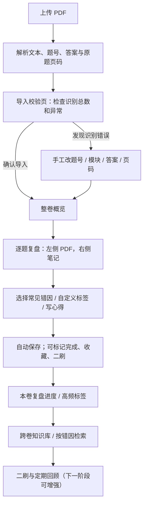

# 行测智能复盘系统｜产品需求与技术设计文档（PRD）

> **项目代号**：行测复盘工作台 / Xingce Review  
> **版本**：v1.0（Codex 开发基线）  
> **日期**：2026-10-31  
> **目标形态**：优先桌面端、兼容手机端的本地 Web 应用  
> **开发方式**：以完整用户闭环为核心，先完成可用 MVP，再逐步增强；不开发微信小程序或原生 App。  
> **真实验收样卷**：`2027年国考第四十季行测模考大赛（行政执法类）.pdf`（用户提供，40 页）。

---

## 1. 产品摘要（给 Codex 首先阅读）

本产品不是刷题 App，也不是仅汇总“错题”的工具。用户完成一整套行测卷子后，将从粉笔等平台导出的 **PDF 试卷**上传到系统。系统尽可能自动识别**题号、六大模块、原题所在页、标准答案、用户答案和对错**。用户在**每一道题（包括答对的题）**旁，勾选该题型常见易错点、添加自己的标签、记录复盘心得，并可以把题加入二刷清单。系统按题型和错误标签汇总过去多套试卷的复盘记录，帮助用户识别反复出现的问题。

**MVP 成功标准**：用户上传样卷 → 检查识别结果 → 从 1 到 130 题逐题浏览原 PDF → 任意题写笔记 / 标签 → 刷新页面后数据不丢 → 查看本卷与跨卷统计 → 导出可恢复的备份。

### 核心产品原则

1. **先录入，后分析**：未经检查的解析数据不得直接生成可信诊断。
2. **原卷是事实来源**：保留和展示原始 PDF；图形、材料、表格以 PDF 为准，不要求把它们全部转成纯文本。
3. **每题都可写**：答对、答错、蒙对、没做的题均可复盘。
4. **标签只是提示，不是诊断**：系统提供候选错因，但不能仅凭“选了 B、答案 D”断言用户出现了哪类错误。
5. **录入省事、复盘自由**：简短标签 + 自由文本为主，避免强制填写繁琐表单。
6. **以长期知识积累为价值**：跨卷检索同类题的复盘心得，比单卷准确率更重要。

---

## 2. 背景、目标与非目标

### 2.1 当前痛点

- 复盘一套 130 题的行测卷耗时很长，缺少统一入口查看原题和自己的反思。
- 只看错题数量与正确率，难以发现“反复出现的相同错误”。
- 错题记录分散在纸张、截图、笔记软件里，难以跨试卷搜索。
- 不同题型的常见失误不同，但通用错题本往往只有一个自由文本框。
- 做对却“蒙对”、耗时过长或者在选项间纠结的题容易被忽略。

### 2.2 第一版目标

- **G1：** 兼容用户提供的粉笔导出 PDF，自动获得可用的逐题索引和答案对照。
- **G2：** 130 道题都能关联独立复盘记录，并便捷查看 PDF 原题。
- **G3：** 不同模块 / 二级题型展示不同的常见易错标签，且支持个人自定义。
- **G4：** 复盘记录自动保存并可备份、恢复；可以跨试卷检索。
- **G5：** 提供可信的基础统计：模块正确率、标签频次、复盘进度、二刷清单。

### 2.3 暂不做（避免 Codex 开发范围失控）

- 不开发注册、登录、支付、社交、排行榜、社区或题库商城。
- 不做在线实时考试或完整的刷题引擎。
- 不承诺识别任意排版 PDF；首版优先可靠支持本样卷格式。
- 不做扫描版 PDF OCR 自动拆题；扫描件可以上传并浏览，但需提示无法自动识别时手工建题。
- 不接大模型，不自动生成标准解析、题目难度或猜测用户错因。
- 不做完整的知识点自动分类模型；首次可以通过规则 + 人工修正。
- 不做微信小程序和原生 App。

---

## 3. 本次真实样卷：开发验收基准

**文件**：`2027年国考第四十季行测模考大赛（行政执法类）.pdf`

样卷实际特征（已检查本地 PDF）：

| 项目 | 确认结果 |
|---|---|
| PDF 页数 | 40 页（第 1 页为封面） |
| 题目数 | 130 题，题号 1–130 |
| 题干 / 选项 | 大部分含可提取文字，也有图形、图片、表格 |
| 答案 | 每题均有“正确答案：X”和“你的答案：X” |
| 全卷结果 | 93 道正确、37 道错误，正确率 71.54% |
| 标准逐题解析 | 该 PDF **未包含**，页面不能凭空展示“官方解析” |
| 特殊排版 | 图形推理是图像；部分题干或共用资料跨页；第 130 题从 PDF 第 39 页开始，内容延至第 40 页 |

### 3.1 模块与题型

| 模块 | 题号 | 题量 | 本样卷正确数 | 正确率 |
|---|---|---:|---:|---:|
| 政治理论 | 1–20 | 20 | 17 | 85.0% |
| 常识判断 | 21–35 | 15 | 4 | 26.7% |
| 言语理解与表达 | 36–65 | 30 | 24 | 80.0% |
| 数量关系 | 66–75 | 10 | 5 | 50.0% |
| 判断推理 | 76–110 | 35 | 26 | 74.3% |
| 资料分析 | 111–130 | 20 | 17 | 85.0% |
| **合计** | **1–130** | **130** | **93** | **71.54%** |

**注意**：上述题号区间是**本份验收样卷**的真实结构，不应写死成所有行测卷的永久规则。后续不同试卷允许调整题型范围。

### 3.2 必测定位样本

| 题号 | PDF 起始页 | 正确 / 我的 | 特别用途 |
|---|---:|---|---|
| 1 | 2 | B / B | 首题识别 |
| 7 | 3 | A / D | 答错判断 |
| 21 | 8 | B / A | 模块切换 |
| 36 | 11 | C / C | 言语模块定位 |
| 41 | 12 | A / D | 逻辑填空错题 |
| 76 | 23 | A / C | 图形推理图片题 |
| 81 | 25 | D / B | 空间图形题，必须看 PDF 图片 |
| 111 | 34 | C / C | 资料分析共用材料 |
| 130 | 39 | D / A | 起始于第 39 页，后续内容在第 40 页 |

导入后至少核对上述题号、模块、页码和两份答案。样卷仅用于本地开发 / 测试，不要将题干和用户信息推送至公共仓库。

---

## 4. 用户与完整操作流程

### 4.1 核心用户

正在准备国考 / 省考的个人考生。通常在电脑上复盘整套卷，手机上查看或补记；第一版优先照顾桌面双栏操作。

### 4.2 主流程（Happy Path）



### 4.3 非典型流程

- **仅有试题，没有答案**：允许导入并按题号复盘；答案显示“未知”，不能纳入正确率分母。允许手动补填答案。
- **答案不全**：缺失“你的答案”标记为“未作答 / 待核对”，不要把它默认为 A 或默认为错误。
- **识别数量不符**：展示异常、来源页码和疑似题号；不得无提示地当作完整 130 题。
- **跨页题 / 共用材料**：定位起始页，并可连续翻看后续页；资料分析须保留共用材料的上下文。
- **重复上传同一 PDF**：通过文件 SHA-256 检测重复；提示继续原卷或显式创建新副本，绝不静默覆盖笔记。
- **刷新 / 退出后再进入**：所有笔记、标签、题型修正和复盘进度保留。

---

## 5. 信息架构和页面设计

### P01｜试卷库 / 首页（必须）

**主功能**：上传 PDF，查看已有试卷和复盘进度，继续上次复盘。

- 主按钮：`上传试卷 PDF`；显示文件大小、上传与解析进度。
- 试卷卡片字段：标题、导入时间、总题数、已复盘题数、正确率（若可计算）、操作“继续复盘 / 统计 / 删除”。
- 支持搜索试卷标题；同名卷可区分导入时间。
- 上传后进入校验页，而不是立即跳到报表。

### P02｜导入校验页（必须）

**主功能**：确保解析可信、可修正。

- 显示文件名、页数、识别题数、标准答案条数、个人答案条数、异常题数。
- 按题号展示 `模块 / 二级题型 / 正确答案 / 我的答案 / 起始 PDF 页 / 解析状态`。
- 允许逐题改正这些字段；标记“含图形”仅做提醒，不要求提取图片。
- 对低置信度、缺失字段、重复题号、跨页问题突出提示。
- 按钮：`确认导入并开始复盘`；校验信息、修改结果应保留。
- 若 PDF 无法自动解析，允许创建一张空白试卷并设置题数、模块和页码（基础兜底）。

### P03｜逐题复盘工作台（**核心页面，最高优先级**）

桌面布局建议：

```text
┌─────────────────────────────────────────────────────────────────────────────┐
│ 行测复盘工作台  / 试卷名                 全卷概览  笔记库  导出备份             │
├─────────────┬─────────────────────────────────┬─────────────────────────────┤
│ 模块 / 状态 │ PDF 原卷（真实页面，支持缩放）   │ 第 81 题 · 图形推理             │
│             │                                 │ 我的答案 B | 正确答案 D  ❌    │
│ [错题]      │ 题干 / 图片 / 共用材料           │                             │
│ [全部]      │                                 │ 作答状态 [蒙对][纠结][超时]     │
│ [未复盘]    │                                 │                             │
│ [已复盘]    │                                 │ 常见易错点（多选）             │
│ [二刷]      │                                 │ [空间折叠] [观察角度] ...      │
│             │                                 │ [+ 自定义标签]                 │
│ 1 2 3 ...   │                                 │                             │
│ 78 79 ...   │                                 │ 我的复盘心得                   │
│             │                                 │ [自由文本输入框             ] │
│             │                                 │                             │
│             │                                 │ [已保存] [标记完成] [加入二刷]  │
│             │                                 │       上一题     下一题        │
└─────────────┴─────────────────────────────────┴─────────────────────────────┘
```

**左侧题号导航**

- 六大模块筛选，显示该模块正确 / 错误 / 未作答数和已复盘数。
- 题号网格可按：全部、答错、答对、未做、待复盘、已完成、蒙对 / 纠结 / 超时、二刷筛选。
- 题号状态用颜色区分，但不能只凭颜色表达，需辅助文字或图标。
- 点击题号不打开新页面，而是在工作台内部切题。

**中间原题区域**

- 默认在 PDF.js 中展示**原 PDF 对应页**，页码与题号关联。
- 支持缩放、翻页、打开全屏；跨页可以看后一页；资料分析共用材料应能向上滚动。
- 不能因为题干提取失败就隐藏原题；PDF 永远可见。
- 在页码已定位、但题目 bbox 未可靠解析时，仅跳转到页面即可，**不做假精确高亮**。
- 可选折叠：题干抽取纯文本供复制检索（此文本可为空）。

**右侧逐题复盘区域**

- 题头：题号、模块、二级题型、答题结果、用户答案与标准答案（若有）。
- `作答情况` 多选：`蒙对 / 猜对`、`犹豫纠结`、`明显超时`、`题目没看完`；没有标记即正常，不要求每题操作。
- `常见易错点`：根据二级题型动态列出标签；多选；可新增个人标签。
- `我的复盘心得`：**一个充足的自由文本框是必需项**，可记录任何思路。占位引导：`当时为什么这样选？关键遗漏是什么？下次碰到类似题时我第一步要做什么？`
- 可选折叠的结构化补充栏：`正确思路 / 更快做法`、`下次识别信号`；不要让它们成为必填项。
- 操作：自动保存（输入停止约 500–800ms 后保存）、显式“标记已完成”、`加入二刷`、上一题 / 下一题。
- 切题前确保编辑中的内容提交；保存失败必须提示并允许重试。
- 允许“只写心得、不勾标签”，也允许“只勾标签、暂不写心得”。

**移动端**

- 切换为 `原题` / `复盘笔记` 两个 Tab 或上下分栏；题号导航置于抽屉。
- 第一版保证可用和不丢数据即可，不追求原生 App 手势。

### P04｜本卷分析（必须）

- 全卷：已解析、正确、错误、未作答、正确率、复盘完成数。
- 按六大模块：题量、正确数、错误数、正确率、复盘完成率。
- 错因标签频次 TOP N：仅对**用户实际标记过**的标签统计；可筛选某模块。
- 待复盘 / 二刷题号快速入口。
- 右下方提示：`标签统计反映你主动记录的问题，不等于所有错题真实错因分布`。
- 不根据正确率直接推断“你的思维问题”，不使用未验证的智能推荐措辞。

### P05｜个人复盘知识库（必须，首版可简化）

- 跨试卷显示个人复盘记录列表：日期、试卷、题号、模块、二级题型、标签、心得摘要、完成状态。
- 搜索：关键词匹配复盘心得 / 自定义标签；按模块、标签、结果过滤。
- 点击记录回到具体试卷的具体题号，原卷同步跳转。
- 统计：过去 N 套试卷各标签出现次数；相同标签频繁出现可作为重点提示，但不直接断言知识未掌握。
- 首版只需基础列表 + 筛选 + 简单趋势，不要求复杂 AI 分析。

---

## 6. 复盘策略设计：借鉴常见方法，但保留用户主动判断

### 6.1 方法转化为产品动作

| 复盘方法 | 具体产品机制 | 是否 MVP |
|---|---|---|
| 错因归类，不笼统写“粗心” | 按模块 / 二级题型提供具体标签，支持自定义 | 是 |
| 错题与蒙对题都要关注 | 对错与“蒙对 / 纠结 / 超时”分别记录 | 是 |
| 先反思再看解析 | 复盘笔记默认可先填写；如未来导入解析，可折叠展示 | 是（不做官方解析自动生成） |
| 同类错误集中回顾 | 跨卷按标签检索，展示历史心得 | 是 |
| 写下“下次怎么做” | 自由心得占位提示和可选“下次识别信号” | 是 |
| 间隔重做，验证掌握 | 二刷清单、重做结果及提醒 | MVP 做清单；自动排期为下一阶段 |
| 总结一题多解 / 更快解法 | 答对题也支持记笔记；可选记“更快做法” | 是 |

> 方法来源见文末参考链接。`1 / 3 / 7 / 14 天`之类间隔只能作为日后可配置的产品默认值，不宣称对每个人或每种知识点都最优。

### 6.2 复盘状态定义

一题有**两个互相独立的维度**：

**答题结果**（由答案比较）：`correct`、`wrong`、`unanswered`、`unknown`。  
**复盘状态**（用户操作）：`not_started`、`in_progress`、`completed`。

另设：`attempt_flags[]`（蒙对、纠结、超时等）和 `review_later`（二刷布尔值）。**不要**把“蒙对”强制映射为“错误”，因为它也可能是选对。

规则：

- 允许任意一道题复盘，即使正确。
- 输入任何文本或选择标签后，状态可自动从 `not_started` 变为 `in_progress`。
- 只有用户点击“标记已完成”才能设置 `completed`，至少需存在一项笔记或标签；允许撤销完成。
- `unanswered` 和 `unknown` 要分别处理，不能合并为错误。
- 初次进入试卷默认筛选“全部”，同时显著提供“先看错题”快捷入口；不能替用户隐藏做对的题。

### 6.3 常见错因标签（第一版内置）

请为标签保存稳定 `code`、显示名称 `label`、所属 `module / subtype`，用户自定义标签与内置标签都以统一的多对多关联存储。

| 模块 / 二级题型 | 候选易错标签（可多选、可自定义） |
|---|---|
| 政治理论 | 哲学原理混淆、政策表述记忆不准、时间 / 主体混淆、绝对化表述误判、组合项逐条判断遗漏、材料关键词未对应 |
| 常识判断·法律 | 法律概念混淆、主体 / 权限判断错误、法条适用不清、程序与实体混淆、例外情形忽视、题干问法看反 |
| 常识判断·科技 / 人文 / 地理等 | 基础知识盲区、概念记错、相似知识混淆、时间地点记忆不准、以常识感觉代替判断 |
| 言语·逻辑填空 | 词义侧重点混淆、固定搭配错误、语境逻辑未识别、感情色彩不符、对应关系遗漏、近义词辨析不清 |
| 言语·片段阅读 | 主旨句定位错误、转折 / 因果关系遗漏、主题词偏离、过度推断、无中生有、选项扩大 / 缩小范围 |
| 言语·语句排序 / 衔接 | 首尾句识别不当、关联词线索遗漏、代词指代混淆、话题一致性忽视、逻辑顺序错误 |
| 数量关系 | 题型识别错误、建模列式错误、条件遗漏、分类讨论不完整、计算出错、未采用代入 / 排除、用时过长未取舍 |
| 判断·图形推理 | 观察方向错误、位置 / 旋转规律遗漏、数量规律遗漏、属性规律遗漏、样式叠加遗漏、空间折叠失误 |
| 判断·定义判断 | 定义主体忽视、限定条件遗漏、必要条件混淆、题干否定问法看反、选项关键信息未核对 |
| 判断·类比推理 | 一级关系误判、二级关系未比较、逻辑关系过度泛化、词义 / 常识干扰、选项排除不彻底 |
| 判断·逻辑判断 | 论点论据混淆、加强削弱方向搞反、因果关系误判、条件推理错误、必要 / 充分条件混淆、真假推理漏情况 |
| 资料分析 | 现期 / 基期混淆、增长率 / 增长量误用、比重 / 平均数公式错误、数据定位错误、单位换算错误、估算精度不当、计算粗心、时间分配不当 |

**标签维护规则**：

- 标签是建议，不是自动贴上的结论；第一版**不得依据标准答案自动生成错因标签**。
- 用户可添加自定义标签、删除自己添加的标签；已被使用的标签要保留历史关联（软删除 / 隐藏）。
- 共性标签如“审题遗漏、时间不足”可在各模块重复展示，但要有稳定代码，避免统计时同名不同义。
- 二级题型由系统预设，解析不准确时可人工修改。

### 6.4 分析优先级策略（透明、可控）

MVP **不引入黑箱“智能评分”**。提供这些排序 / 筛选：

1. 先看错题。
2. 再看用户标记的蒙对、纠结、超时题。
3. 再看尚未复盘的题。
4. 需要巩固的题进入二刷清单。

后续在存在多套卷数据后，可选显示“同类标签近 N 卷重复出现”提醒。所有推荐需写明触发原因，例如：`“现期 / 基期混淆”在你已标记的最近 5 套卷中出现 7 次`。不可宣称 7 次代表全体错题中的绝对真实频率。

---

## 7. 核心数据模型（建议 SQLite；实体名可调整，语义不可缺）

以下是**逻辑数据模型**，供 ORM / 数据库迁移实现；建议用 UUID 作为主键。多表关联应有外键和唯一约束。

### 7.1 papers（试卷）

```text
id: UUID PK
title: text
source_filename: text
sha256: text               # 全文件去重参考
file_path: text            # 后端保管路径；不要相信用户提交的任意路径
page_count: integer
question_count: integer
source_type: enum('fenbi_pdf','generic_pdf','manual')
parse_status: enum('pending','needs_review','confirmed','failed')
parser_version: text
created_at, updated_at: datetime
```

### 7.2 questions（题目）

```text
id: UUID PK
paper_id: UUID FK -> papers.id
number: integer
module: text               # 政治理论 / 常识判断 / 言语理解 / 数量关系 / 判断推理 / 资料分析
subtype: text              # 逻辑填空 / 图形推理等；可手动修正
page_start: integer        # PDF 1-based 页码
page_end: integer|null     # 跨页题；最初允许推定 / 手工修正
stem_preview: text|null    # 仅作检索辅助，不代替原 PDF
correct_answer: 'A'|'B'|'C'|'D'|null
user_answer: 'A'|'B'|'C'|'D'|null
answer_status: enum('correct','wrong','unanswered','unknown')
parse_confidence: enum('high','medium','low')
parse_warnings: JSON list
created_at, updated_at: datetime
UNIQUE(paper_id, number)
```

其中 `answer_status` 根据答案字段派生 / 同步：

- 标准答案与个人答案均存在且相等 → `correct`。
- 标准答案与个人答案均存在且不同 → `wrong`。
- 标准答案存在、用户明确没作答 → `unanswered`。
- 标准答案缺失 / 无法判断是否作答 → `unknown`。

如原 PDF 中有 `未作答` 标识，应单独解析，不要把缺失值误认为“用户明确没做”。

### 7.3 reviews（每题一个当前复盘记录）

```text
id: UUID PK
question_id: UUID UNIQUE FK -> questions.id
status: enum('not_started','in_progress','completed')
attempt_flags: JSON list     # guessed, hesitant, overtime, unread_stem
note: text                  # 自由复盘心得，核心字段
correct_method: text|null   # 可选：更优做法 / 正确思路
next_time_rule: text|null   # 可选：下次识别信号
review_later: boolean       # 加入二刷清单
completed_at: datetime|null
created_at, updated_at: datetime
```

### 7.4 tags 与 review_tags

```text
tags:
  id: UUID PK
  code: text UNIQUE
  label: text
  module: text|null
  subtype: text|null
  origin: enum('system','custom')
  is_active: boolean

review_tags:
  review_id: UUID FK -> reviews.id
  tag_id: UUID FK -> tags.id
  PRIMARY KEY(review_id, tag_id)
```

### 7.5 第二阶段预留（MVP 不必建表）

`review_attempts`：题目二刷尝试、是否正确、耗时、时间戳；`study_tasks`：复习提醒；`attachments`：个人截图 / 图片批注；`review_history`：笔记修改历史。MVP 可后续增加迁移，不要提前做完所有功能。

---

## 8. PDF 导入与解析要求（最高技术风险）

### 8.1 解析策略

建议首版针对 `fenbi_pdf` 使用明确的可测试解析器，不追求一个万能正则。

1. 后端使用 **PyMuPDF** 打开 PDF，读取页数、文本块及布局坐标；保存原文件供原题预览。
2. 排除封面、页眉页脚等干扰；识别形如 `1.`、`2.` 的题号并结合坐标、顺序、所在模块校验，避免把小数误识别成题号。
3. 识别模块标题（`一. 政治理论`、`二. 常识判断`等），根据题号确定题型区间；解析失败时允许人工修正。
4. 识别成对标识 `正确答案：B` 与 `你的答案：D`，结合页面及阅读顺序关联具体题号。
5. 特别注意 PDF 的文本流顺序可能把 `正确答案` 放在题干之前；**不得只用未经验证的“第 N 个答案配第 N 题”算法处理任意 PDF**。对本样卷允许在测试确认 130 组顺序完全一致后使用受控规则，并记录版本。
6. 为每题记录 `page_start` 和可能的 `page_end`；第一版可只定位起始页并允许向下翻页，跨页问题可手工修正。
7. 对原 PDF 中的图片题 / 表格题保留原页，不必把图形识别为文字。
8. 所有自动字段带置信度 / 异常提示；导入校验页供用户确认。
9. 用户修正结果写入数据库，不修改原始 PDF 文件。

### 8.2 必须识别的异常

- 题号缺失、不连续、重复或大于声明题量。
- 个人答案数量与标准答案数量不一致。
- 同一题定位到多个起始页 / 页码越界。
- 题干为空、图片较多、可复制文本不足。
- `正确答案` 或 `你的答案` 为非常规内容，如“未作答”。
- 扫描 PDF 没有可提取文本：提供可浏览模式、手动录入提示，而不是报“成功导入 0 题”。

### 8.3 性能与正确性原则

- 解析应支持运行进度和明确失败原因；失败不可产生半套“已确认”的脏数据。
- 所有校验先在后端完成，前端不能以“解析完成”替代“解析可信”。
- 从文件名、用户输入、PDF 文本中读取的内容均按**不可信数据**处理，展示时防 XSS。
- 必须保留 PDF 原件，使识别错误不影响正常做笔记。
- 结果仅展示确定知道的值；缺字段用 `— / 待核对`，不编造。

---

## 9. 第一版技术方案（明确给 Codex 的建议）

### 9.1 技术选型

| 层次 | 推荐方案 | 理由 |
|---|---|---|
| 前端 | Vue 3 + TypeScript + Vite | 适合长期维护的单页应用 |
| UI | Element Plus + 自定义 CSS | 表单、抽屉、导航、弹窗开发快 |
| PDF 查看 | PDF.js / `pdfjs-dist` | 原版呈现图片、表格、跨页内容和缩放 |
| 图表 | ECharts | 模块统计、标签排行 |
| 后端 | Python + FastAPI + Pydantic | 文件上传、校验、PDF 解析 API |
| PDF 解析 | PyMuPDF | 提取文本、页码、坐标与页渲染 |
| 数据库 | SQLite + SQLAlchemy + Alembic | 单人本地使用，轻量、数据可迁移 |
| 文件存储 | `data/uploads/` | 按 hash / UUID 命名，不暴露真实上传路径 |
| 测试 | pytest + Vitest（可选 Playwright） | 用样卷做回归测试 |

**为何首版需要后端**：本项目最难的是不同布局的 PDF 解析，Python / PyMuPDF 更易调试与维护；单纯 `localStorage + 静态 HTML` 不能满足多卷可靠导入、持久备份及解析可信性。

### 9.2 推荐目录结构

```text
xingce-review/
├── README.md
├── docs/
│   └── PRD.md
├── backend/
│   ├── pyproject.toml           # 或 requirements.txt
│   ├── app/
│   │   ├── main.py
│   │   ├── api/                # papers, questions, reviews, analytics, tags, backups
│   │   ├── core/               # config, errors, storage
│   │   ├── models/             # ORM
│   │   ├── schemas/            # Pydantic
│   │   ├── services/           # import, analytics, backups
│   │   └── parsers/
│   │       ├── base.py
│   │       └── fenbi.py        # 首版支持的样卷解析器
│   ├── alembic/
│   └── tests/
│       ├── test_import_fenbi.py
│       ├── test_reviews.py
│       └── test_analytics.py
├── frontend/
│   ├── package.json
│   └── src/
│       ├── pages/              # PaperList, ImportReview, Workspace, PaperAnalytics, KnowledgeBase
│       ├── components/         # PaperViewer, QuestionNavigator, ReviewEditor, TagSelector
│       ├── api/
│       ├── stores/
│       └── types/
├── data/                        # 本地数据库、PDF；不提交到 Git
├── .gitignore
└── .env.example
```

`data/` 和原始 PDF 应写入 `.gitignore`。开发仓库**默认不上传**题库 PDF 或用户笔记；如需端到端测试，将样卷放入本地 `tests/fixtures/private/` 并忽略该目录，仓库仅提交无版权问题的人工合成测试 PDF。

### 9.3 API 合同（建议）

| 方法与路径 | 功能 |
|---|---|
| `POST /api/papers/import` | 上传 PDF，解析成待确认草稿，返回导入结果和 warnings |
| `GET /api/papers` | 试卷列表 / 进度 |
| `GET /api/papers/{paper_id}` | 试卷元数据和总体统计 |
| `GET /api/papers/{paper_id}/questions` | 题目列表；支持模块、答题结果、复盘状态筛选 |
| `PATCH /api/questions/{question_id}` | 校正答案、模块、二级题型、起止页 |
| `POST /api/papers/{paper_id}/confirm` | 确认导入完成 |
| `GET /api/papers/{paper_id}/pdf` | 本地 PDF 读取 / Range 支持（用于 PDF.js） |
| `GET /api/questions/{question_id}/review` | 获取该题复盘信息 |
| `PUT /api/questions/{question_id}/review` | 幂等保存复盘心得、标签、状态 |
| `GET /api/tags` | 获取系统标签和自定义标签 |
| `POST /api/tags` | 新建自定义标签 |
| `GET /api/analytics/papers/{paper_id}` | 本卷统计 |
| `GET /api/analytics/overview` | 跨卷统计 |
| `GET /api/reviews` | 笔记库检索与过滤 |
| `GET /api/backups/export` | 导出 JSON 备份 |
| `POST /api/backups/import` | 预览并确认 JSON 备份恢复 |
| `DELETE /api/papers/{paper_id}` | 删除试卷和关联记录（弹出确认） |

API 返回需一致使用 `{ data, error, meta }` 或相同风格，建议 OpenAPI 自动生成。对于保存类接口，用事务确保标签与笔记一致写入。

**保存复盘的参考请求**：

```json
{
  "status": "completed",
  "attempt_flags": ["hesitant"],
  "tag_ids": ["<system-tag-uuid>", "<custom-tag-uuid>"],
  "note": "本题我先凭选项感觉判断，没有先看论点和论据。",
  "correct_method": "先确定题目要加强还是削弱，再拆解论证。",
  "next_time_rule": "先找论点、论据及其关系，再逐项比较选项作用。",
  "review_later": true
}
```

**统计口径必须清晰**：

- **可判题数** = 正确 + 错误。`正确率 = 正确数 / 可判题数 × 100%`；未作答和未知单独显示。
- 若所有题都有明确答案（如本样卷），可判题数 = 总题数。
- **复盘完成率** = completed 题数 / 总题数。
- **标签频次** = 实际被该标签标记的复盘题数（每题同一标签只计一次），可按试卷 / 模块筛选；允许一题多个标签，因此各标签数量之和可超过有标签的题数。
- **重复错因** 指相同标签在不同试卷的实际标记次数，不是模型推断出的真实错因。

### 9.4 本地运行与隐私

- 推荐本地 `http://localhost:5173` 前端 + `http://localhost:8000` API，数据库保存在本地。
- CORS 仅允许开发时已知源，后期部署再另行配置，不允许无条件 `*` 搭配敏感接口。
- 上传限定 `.pdf` 且校验文件魔数、限制体积（建议默认 30MB，可配置）。
- 对 PDF 解析异常、损坏文件、安全边界明确报错；不要执行 PDF 内嵌脚本。
- 使用安全生成的文件名存储，防目录穿越；导出笔记时不要返回服务端绝对路径。
- 备份至少包括试卷元数据、题目修正数据、标签、笔记、复盘状态和版本号；明确**是否含原始 PDF**。MVP 可以导出不含 PDF 的 JSON，并提醒用户原 PDF 需另行保管；导入备份时核对 PDF 的 hash，避免题号错配。
- 数据库和备份需支持中文和 emoji。删除时二次确认，并提示这是本地操作。

---

## 10. 关键交互与边界判定

### 10.1 保存规则

- 自动保存输入结束后 500–800ms；切换题目 / 切换路由时及时 flush。
- 前端显示 `未保存 / 保存中 / 已保存 / 保存失败` 状态。
- HTTP 失败时保留用户当前输入；可重试，绝不清空输入框。
- `PUT` 更新同题同一份当前笔记，不应每次输入新增一条 review。
- 取消已完成状态时保留笔记、标签和二刷标记。

### 10.2 搜索与过滤

- 试卷内题号筛选与笔记库筛选应以**数据库中的真实字段**为依据，不要仅凭前端硬编码状态。
- 搜索中文关键词、按标签搜索可以组合使用；列表需展示无结果提示。
- 点击跨卷搜索结果可精确定位：`paper_id + question.number`。

### 10.3 统计中的空数据

- 没有复盘标签 → 显示“尚未记录易错标签”，不显示虚构高频项。
- 缺标准答案 → 显示“无法计算正确率”，不能显示 0%。
- 仅有 1 套卷 → 不写“长期薄弱 / 稳定改善”的结论。
- 只有答对题的笔记 → 仍计入笔记完成进度和方法库，但不等于错误次数。

---

## 11. 功能优先级与开发里程碑

### M0｜工程底座（先完成）

- [ ] Vue + FastAPI + SQLite 启动正常；提供本地启动指令。
- [ ] 建表和初始标签 seed；后端 OpenAPI 正常。
- [ ] PDF 上传、校验、保存原件、可在前端查看。
- [ ] 单元测试和 `.gitignore` / `.env.example` 配好。

### M1｜整卷导入 / 校验（阻塞核心功能）

- [ ] 对样卷可靠识别 130 个题号，关联 130 组正确 / 个人答案。
- [ ] 识别六大模块；支持用户修正二级题型、答案和起始页。
- [ ] 导入校验页展示异常与确认入口。
- [ ] 重复文件上传不会无提示覆盖。

### M2｜逐题复盘（**真正的 MVP 交付点**）

- [ ] 题号导航与过滤；PDF 题目页定位；图形题清晰可见。
- [ ] 每题独立的标签、自由心得、作答标记、二刷标记。
- [ ] 自动保存 / 错误重试；切题 / 刷新数据不丢。
- [ ] 答对题也能完整复盘；已完成数自动更新。

### M3｜分析与知识库

- [ ] 本卷模块正确率 / 复盘完成率。
- [ ] 标签频次、筛选、二刷入口。
- [ ] 跨卷笔记库、检索与回跳。
- [ ] JSON 备份与恢复；删除试卷。

### M4｜第二阶段，MVP 验收通过后再开始

- [ ] 解析更多 PDF 模板、扫描件 OCR、精确题目高亮 / 截图。
- [ ] 单题官方解析额外导入或用户手动附加。
- [ ] 二刷结果记录、间隔提醒、错因重复趋势、PWA 安装。
- [ ] 用户明确允许后再研究 AI 辅助归纳心得；AI 只能提供建议，来源和置信度可见。

**严格执行**：不要在 M1 未稳定时为了“高级感”先开发 AI 诊断、登录和漂亮的复杂大屏。

---

## 12. 验收标准（Definition of Done）

### A. 导入正确性（针对真实样卷）

- [ ] 样卷 PDF 上传成功，显示 **40 页 / 130 题**。
- [ ] 正确答案恰好 **130** 条，个人答案恰好 **130** 条，题号 1–130 不重复、不缺漏。
- [ ] 统计 **93 正确 / 37 错误 / 71.54%**。
- [ ] 六大模块统计与第 3.1 节完全一致。
- [ ] 第 7、21、41、76、81、130 题的答案与第 3.2 节一致。
- [ ] 点击第 81 题能看到 PDF 第 25 页的图形；第 130 题可在第 39–40 页之间查看。
- [ ] 解析失败或缺字段时明确提示，支持人工修正，不能虚构内容。

### B. 逐题复盘功能

- [ ] 任一题（包含正确题）都可添加多个系统标签、自定义标签与文本心得。
- [ ] 标记 `蒙对 / 纠结 / 超时` 不影响题目的原始对错。
- [ ] 同时打开不同题，笔记和标签不会串题。
- [ ] 保存后刷新页面、重启后端，笔记和状态不丢。
- [ ] 在文本框输入时点击下一题，内容能够正确保存或明确显示失败。
- [ ] “标记已完成”和“加入二刷”可独立设置、可撤销。

### C. 汇总和备份

- [ ] 每个模块的题数、正确率与完成进度正确。
- [ ] 同题勾选同一标签多次，统计仍只计 1 次。
- [ ] 未填写任何标签时，标签图表显示空态。
- [ ] 备份导出后可恢复同一份试卷下的心得、标签及状态。
- [ ] 删除试卷会正确清除关联复盘记录，且用户需二次确认。

### D. 工程质量

- [ ] `README.md` 说明依赖安装、启动、数据库位置、导入样卷、运行测试、备份方式。
- [ ] 后端关键解析、统计与保存规则具有自动化测试。
- [ ] 前端 API 请求有加载、成功、失败状态；没有控制台阻断性错误。
- [ ] 代码和类型规范清晰，无真实用户 PDF / 个人笔记泄漏到 Git。

---

## 13. 推荐的用户验收场景（手工操作）

1. 打开首页，上传该粉笔 PDF；校验页看到 40 页、130 题，检查六大模块与 93/37。
2. 进入逐题复盘，点击第 21 题，可查看常识法律题并确认自己选 A、标准 B。
3. 在第 21 题勾选“法律概念混淆”，自定义“行政许可权限”，写下心得，标记已完成。
4. 跳至第 81 题，看原始空间图形，选择“空间折叠失误”，写笔记，加入二刷。
5. 跳至第 1 题（正确），记录“这道题可以更快识别适度原则”；验证答对题也能保存。
6. 刷新前端，三题的复盘内容仍存在；试卷完成数是 3。
7. 打开分析页，能看到这三道题各自的标签和模块分布；未填写的题不会被自动贴标签。
8. 新导入另一份 PDF 后，能在知识库同时搜索两份卷子的心得并跳回对应原题。
9. 导出备份，清空测试数据，重新导入备份，验证数据完整恢复。

---

## 14. 参考资料与使用边界

产品的“具体错因 + 同类归纳 + 再验证”设计，参考了以下公开备考建议；“重做比只读解析更好、适当分散练习”等原则有教育心理学研究支持。**这些来源用于指导产品的交互设计，不代表特定复盘间隔或优先级算法已在行测考试中被证实最优**。

1. 粉笔：《公考刷题提分技巧：复盘统计表—错因三类归因》（2026），https://www.fenbi.com/page/information-hub-detail/1866
2. 华图：《2026 国考行测备考：资料分析从刷题到提分的进阶之路》，https://m.hb.huatu.com/gjgwy/1867602.html
3. 华图：《2027 年刷题班结束后怎么复盘知识点》（2026），https://m.huatu.com/2026/0521/2863052.html
4. Carpenter 等：《The science of effective learning with spacing and retrieval practice》（2022），https://www.nature.com/articles/s44159-022-00089-1
5. McDermott：《Practicing Retrieval Facilitates Learning》（2021），https://pubmed.ncbi.nlm.nih.gov/33006925/

---

## 15. 给 Codex 的实施纪律

- **先读完整 PRD，再实施 M0、M1；M1 验收通过后再做 M2 和 M3。**
- 开发时尽量复用组件和数据模型，不能把唯一的样卷题号、答案写死在前端。
- 首版只支持粉笔 PDF 的高可靠解析，不需要伪装支持所有考试平台。
- 每个里程碑结束：运行测试、写出已完成项、不能完成的项与下阶段建议。
- 重要假设写入 README；遇到解析不确定宁可提示“待核对”，不要给出错误但自信的统计。
- 解析器与数据库字段分别建模，避免将 UI 展示与 PDF 处理混在一个巨大文件中。
- 保留用户已有笔记，迁移数据库时不得随意删除数据。

**产品最终体验目标：用户复盘的是“自己的思考过程”，PDF 上传与数据统计只是在帮用户减少机械劳动。**
